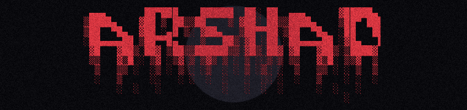
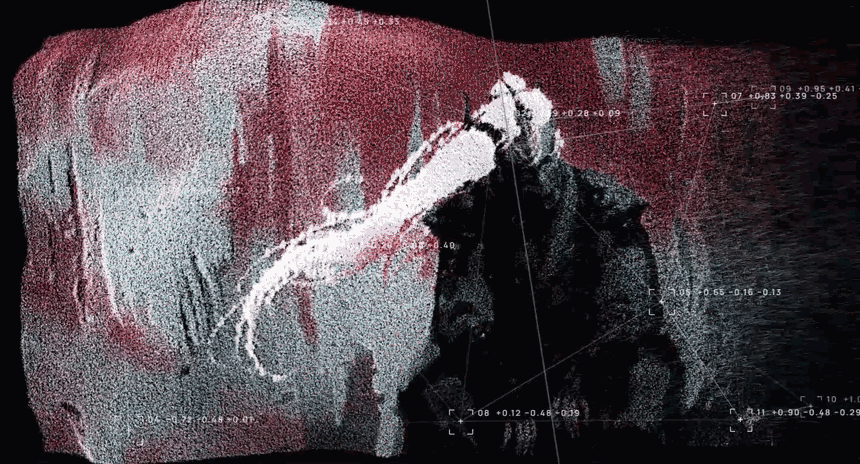

<div align="center">

<!-- Grainy Shimmering Bloody ARSHAD Title Banner -->
<a href="https://github.com/Aral-549">
  
</a>

<!-- Be of Dao Point-Cloud 3D Animation -->
<p align="center">
  
</p>

<!-- Circular Crimson & Shadow Socials -->
<p align="center">
  <a href="https://www.linkedin.com/in/shaik-arshad-ali-45483930b" target="_blank">
    
  </a>&nbsp;&nbsp;&nbsp;&nbsp;&nbsp;&nbsp;
  <a href="https://x.com/SR2449179919432" target="_blank">
    
  </a>&nbsp;&nbsp;&nbsp;&nbsp;&nbsp;&nbsp;
  <a href="mailto:shaikali51449@gmail.com" target="_blank">
    
  </a>&nbsp;&nbsp;&nbsp;&nbsp;&nbsp;&nbsp;
  <a href="https://github.com/Aral-549" target="_blank">
    
  </a>
</p>

<p align="center">
  <em>"The Nightmare grows stronger. So do I."</em>
</p>


</div>

```
 [ASPECT] .............. CS Student @ MIT Manipal
 [TRUE NAME] ........... Shaik Arshad Ali
 [SHADOW NAME] ......... Aral-549
 [RANK] ................ Aspiring Ascended
 [FLAW] ................ Builds too many things at hackathons
 [CORE] ................ Next.js | Django | PostgreSQL
 [ASPECT ABILITIES] .... TypeScript, Python, Solidity, Docker
 [SOUL SEA] ............ Voice AI, Web3, Defense Tech, Healthcare
 [STATUS] .............. Seeking new trials (internships)
```


### // MEMORIES (equipped)

<div align="center">


</div>


### // SHADOW FRAGMENTS

```
  ____________________________________________________________________
 |                                                                    |
 |  [SAINT]  chess.voice                                              |
 |  ................................................................  |
 |  Tournament chess played entirely by voice.                        |
 |  Built for blind players. AssemblyAI + deterministic engine.       |
 |  Rank: Ascended    |    Core: TypeScript                           |
 |____________________________________________________________________|

  ____________________________________________________________________
 |                                                                    |
 |  [DEVIL]  engram                                                   |
 |  ................................................................  |
 |  Cross-app portable AI memory on Monad.                            |
 |  Agents ask, your vault answers. Passkey-secured.                  |
 |  Rank: Corrupted   |    Core: TypeScript, Solidity                 |
 |____________________________________________________________________|

  ____________________________________________________________________
 |                                                                    |
 |  [ECHO]   dogfood-portal                                           |
 |  ................................................................  |
 |  Internal testing and QA portal.                                   |
 |  Built with Python.                                                |
 |  Rank: Awakened    |    Core: Python                               |
 |____________________________________________________________________|

  ____________________________________________________________________
 |                                                                    |
 |  [DEMON]  aushadh-grid                                             |
 |  ................................................................  |
 |  Federated AI for PHC medicine supply chains.                      |
 |  Code for Communities hackathon.                                   |
 |  Rank: Fallen      |    Core: Python, HTML                         |
 |____________________________________________________________________|
```

> **[chess.voice](https://github.com/Aral-549/chess.voice)** | **[engram](https://github.com/Aral-549/engram)** | **[dogfood-portal](https://github.com/Aral-549/dogfood-portal)** | **[aushadh-grid](https://github.com/Aral-549/aushadh-grid)**


### // SOUL CORE

```
  +====================================================================+
  |                                                                    |
  |   COMMITS .............. 285       STARS ............... 0         |
  |   PULL REQUESTS ........ 6         ISSUES .............. 2         |
  |   REPOS CONTRIBUTED .... 1         PUBLIC REPOS ........ 18        |
  |   TOTAL CONTRIBUTIONS .. 497       SINCE ............... Jun 2025  |
  |                                                                    |
  +====================================================================+
  |                                                                    |
  |   TOP LANGUAGES                                                    |
  |   ................................................................  |
  |   TypeScript .... [################----------] 41.35%              |
  |   HTML .......... [############--------------] 29.97%              |
  |   Python ........ [########------------------] 19.68%              |
  |   JavaScript .... [##------------------------] 3.98%               |
  |   Solidity ...... [#-------------------------] 2.38%               |
  |   CSS ........... [#-------------------------] 2.17%               |
  |                                                                    |
  +====================================================================+
  |                                                                    |
  |   STREAK                                                           |
  |   ................................................................  |
  |   Total Contributions ........... 497                              |
  |   Current Streak ................ 1 day                            |
  |   Longest Streak ................ 6 days (Sep 24 - Sep 29, 2025)  |
  |                                                                    |
  +====================================================================+
```


### // NIGHTMARE GRAPH

<div align="center">

<picture>
  <source media="(prefers-color-scheme: dark)" srcset="https://github-readme-activity-graph.vercel.app/graph?username=Aral-549&theme=high-contrast&hide_border=true&area=true&color=E63946&line=E63946&point=ffffff&area_color=E6394633&bg_color=0A0A0A">
  
</picture>

</div>


<div align="center">

```
 "In the dark, I found my shadow. In the shadow, I found my strength."
```


</div>
